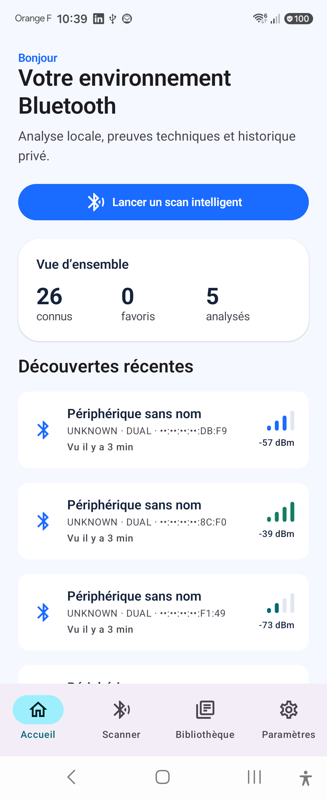
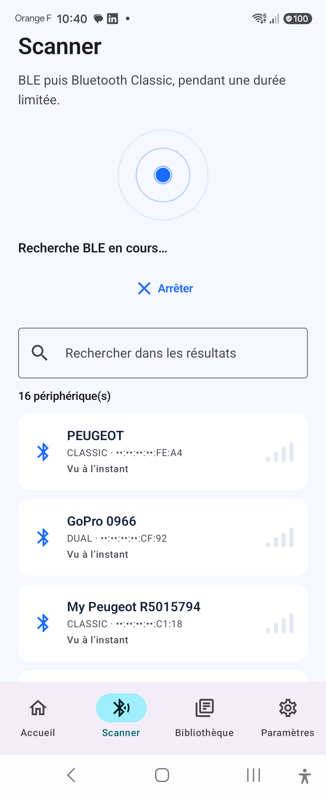
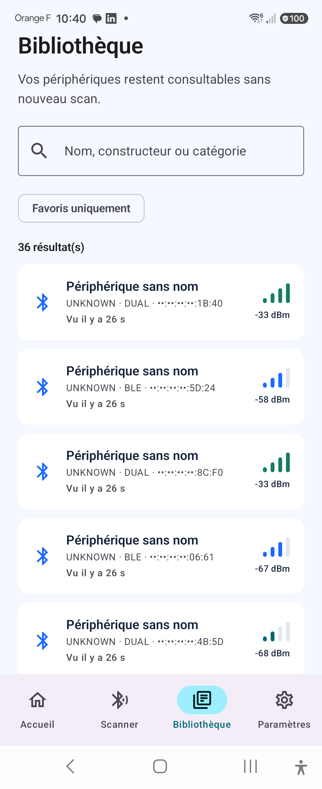
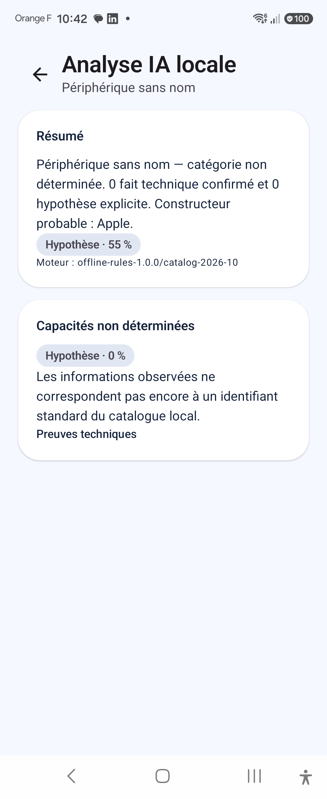
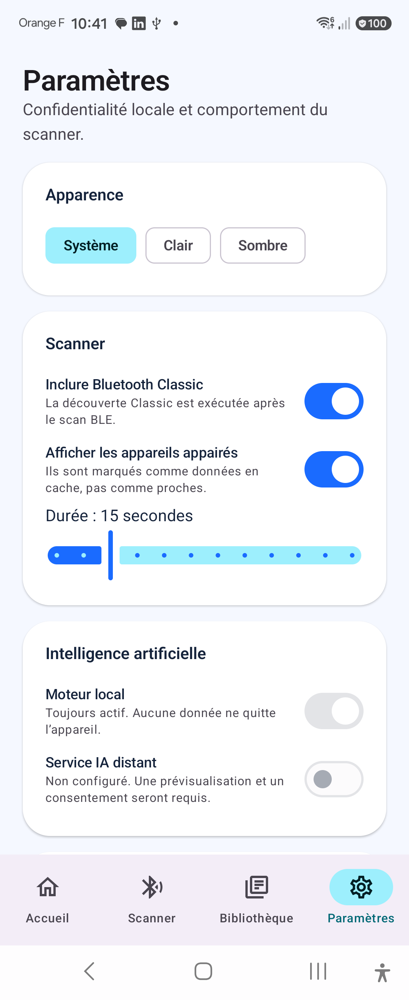

# BlueScope AI

BlueScope AI est une application Android en français qui découvre les périphériques BLE et Bluetooth Classic, explique uniquement ce qui peut être étayé techniquement, explore GATT après consentement explicite et conserve un historique local chiffré.

Le projet cible notamment le Samsung Galaxy Z Flip 7 et reste adaptatif aux autres formats Android. Il fonctionne hors ligne par défaut et n’embarque ni SDK publicitaire, ni télémétrie distante, ni clé API.

## État du produit

- Scan BLE puis Classic borné, résultats temps réel, RSSI, recherche et déduplication prudente.
- Appareils appairés distingués du voisinage réellement observé.
- Exploration GATT en lecture seule : services, caractéristiques, descripteurs et lectures explicitement autorisées.
- Moteur d’identification hors ligne avec preuves, confiance et séparation stricte `CONFIRMED` / `INFERRED`.
- Room versionnée, historique, favoris, notes, bibliothèque hors ligne et DataStore.
- Identifiants Bluetooth persistants chiffrés via Android Keystore ; sauvegardes système exclues.
- Export JSON masqué par défaut et import borné/validé.
- Material 3, thèmes clair/sombre, navigation française et composants accessibles.
- CI : lint, tests JVM, APK debug, compilation release et tests instrumentés sur émulateur.

Les validations radio réelles restent explicitement à exécuter sur matériel ; voir [le rapport de tests](docs/TEST_REPORT.md).

## Aperçu sur Galaxy Z Flip 7

Captures réalisées sur le Samsung Galaxy Z Flip 7 pendant la validation terrain. Les adresses Bluetooth sont masquées par l’application ; les appareils visibles correspondent à l’environnement radio de test.

<p align="center">
  
  
  
  
  
</p>

<p align="center"><em>Accueil · Scan borné · Bibliothèque hors ligne · Analyse fondée sur des preuves · Réglages locaux</em></p>

## Construire

Pré-requis : Android Studio 2026.1 ou supérieur, Android SDK 37, Build Tools 36.0.0 et JDK 17+. Le wrapper utilise Gradle 9.6.0 et AGP 9.5.1.

```bash
./gradlew lintDebug
./gradlew testDebugUnitTest :core:domain:test :core:ai:test
./gradlew assembleDebug
```

Sur cette machine, sans JDK système :

```bash
JAVA_HOME='/Applications/Android Studio.app/Contents/jbr/Contents/Home' \
ANDROID_HOME="$HOME/Library/Android/sdk" \
./gradlew assembleDebug
```

APK généré : [`app/build/outputs/apk/debug/app-debug.apk`](app/build/outputs/apk/debug/app-debug.apk).

La variante release active R8 et la réduction des ressources, mais aucune clé de signature n’est stockée dans le dépôt. Fournir une signature depuis un coffre CI ou un fichier local non versionné.

## Structure

```text
app                 Application, Hilt, navigation et écrans Compose
core/domain         Modèles, invariants, contrats et cas d’usage Kotlin purs
core/bluetooth      Scanner BLE/Classic, permissions, parsing et GATT read-only
core/database       Room, DAO, relations et schémas exportés
core/ai             Catalogue local et moteur d’identification evidence-first
core/data           Repositories, DataStore, chiffrement, import/export
core/designsystem   Thème et composants Material 3 réutilisables
```

La direction des dépendances est documentée dans [ARCHITECTURE.md](docs/ARCHITECTURE.md).

## Documentation

- [Architecture](docs/ARCHITECTURE.md)
- [Installation Galaxy Z Flip 7](docs/INSTALLATION_Z_FLIP_7.md)
- [Permissions Bluetooth](docs/PERMISSIONS.md)
- [Rapport de tests](docs/TEST_REPORT.md)
- [Backlog](docs/BACKLOG.md)
- [Confidentialité](docs/PRIVACY.md)
- [Limites et feuille de route](docs/LIMITATIONS.md)
- [Décisions d’architecture](docs/adr/README.md)

## Principes de sécurité

BlueScope n’essaie jamais de contourner l’appairage, l’authentification ou le chiffrement. Le scanner n’émet rien, GATT n’écrit rien, les notifications ne sont pas activées automatiquement et aucune API Android cachée n’est utilisée. Un service annoncé est présenté comme annoncé ; il n’est déclaré accessible qu’après une découverte GATT réussie.

## Licence et sources des identifiants

Le catalogue embarqué est une sélection versionnée d’Assigned Numbers, avec attribution Bluetooth SIG dans le moteur. Les marques et noms appartiennent à leurs propriétaires. Une mise à jour complète du catalogue doit conserver les conditions de redistribution de la source Bluetooth SIG et passer la revue juridique du produit.
